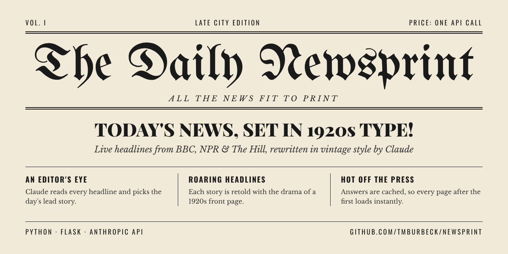

# The Daily Newsprint

A Flask web application that gathers real-time news from major outlets and reimagines it as a vintage 1920s broadsheet.



## Features

- **Live RSS feeds** from BBC, NPR, and The Hill, updated on every page load
- **AI-picked lead story**: Claude chooses the most newsworthy story of the moment
- **1920s headline rewriting**: Claude rewrites every headline in the dramatic style of a vintage newspaper
- **Broadsheet layout**: three-column grid with period-appropriate fonts (one column on phones)
- **Response caching**: each headline is only sent to the API once, so the app stays fast after the first load
- **Works without an API key**: if Claude is unavailable, the page still loads with the original headlines

## Tech Stack

- Python / Flask
- Jinja2 templating
- feedparser (RSS parsing)
- Anthropic API (claude-sonnet-4-6)
- HTML / CSS (Google Fonts: Playfair Display, UnifrakturMaguntia, Oswald, Libre Baskerville)

## Setup

1. Clone the repository

   ```bash
   git clone https://github.com/tmburbeck/newsprint.git
   cd newsprint
   ```

2. Create a virtual environment and install dependencies

   ```bash
   python -m venv .venv
   ```

   Activate it. On Windows:

   ```bash
   .venv\Scripts\activate
   ```

   On macOS / Linux:

   ```bash
   source .venv/bin/activate
   ```

   Then install:

   ```bash
   pip install -r requirements.txt
   ```

3. Create a `.env` file in the project root containing your API key

   ```
   ANTHROPIC_API_KEY=your-api-key-here
   ```

4. Run the app

   ```bash
   python app.py
   ```

5. Visit `http://127.0.0.1:5000` in your browser

## How It Works

1. `feeds.py` downloads the latest stories from each outlet's RSS feed and strips HTML out of the summaries.
2. `rewriter.py` asks Claude which story is most newsworthy and rewrites each headline in 1920s style.
3. Claude's answers are saved to `cache.json`, so a headline is never sent to the API twice.
4. `app.py` puts it together and renders `templates/index.html`.

## Project Structure

```
newsprint/
├── app.py              # Flask route that builds the front page
├── feeds.py            # RSS fetching and summary cleanup
├── rewriter.py         # Claude API calls and caching
├── templates/
│   └── index.html      # Front page template
├── static/
│   └── style.css       # Vintage broadsheet styling
├── .env                # API key (not committed)
└── requirements.txt    # Dependencies
```

## Notes

- The first page load is slower while Claude rewrites the headlines; later loads reuse the cache.
- To add or swap a news outlet, edit the `FEEDS` dictionary in `feeds.py`.
- Never commit your `.env` file; it's excluded via `.gitignore`.
